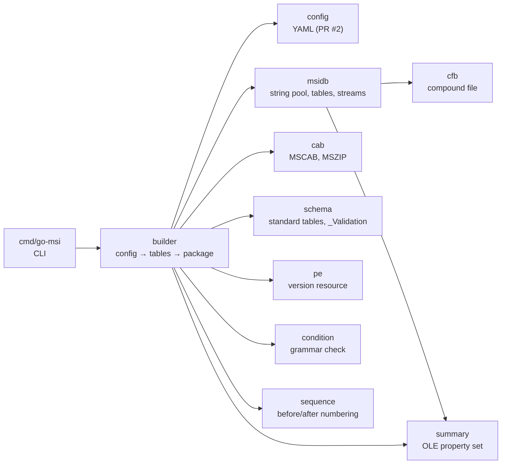

# go-msi writer architecture and implementation plan

go-msi turns one YAML file ([`yaml-schema.md`](yaml-schema.md)) into an
`.msi` package. It only builds packages: it never opens, installs or executes
one, except in tests that run on a disposable Windows machine. Everything is
pure Go with no cgo and builds and runs on Linux, macOS and Windows.

The rules come from [`docs/spec/MSISPEC.md`](../spec/MSISPEC.md) and the
Windows results in [`docs/spec/MSISPEC-RESULTS.md`](../spec/MSISPEC-RESULTS.md).
Section numbers below refer to the specification. WiX and Wine source code is
never consulted (both are LGPL); Wine may run as a black-box test runtime.

## 1. Package map

Each package is independently usable, has no cgo and no platform-specific
code, and is tested on its own. Arrows point from a package to what it imports.



| Package | Responsibility | Spec | Depends on |
|---|---|---|---|
| `cfb` | Compound File Binary v3/v4 writer and reader: sectors, FAT, DIFAT, mini stream, red-black directory tree, name comparison | §2 | stdlib |
| `cab` | Cabinet writer and reader: one folder per cabinet, stored or MSZIP blocks with carried DEFLATE history, checksums on every block | §5 | stdlib (`compress/flate`) |
| `summary` | `\u0005SummaryInformation` property-set writer and reader (PIDs 1–19, VT_I2/I4/LPSTR/FILETIME) | §4 | stdlib |
| `msidb` | The database: column types, typed rows, stream-name encoding, string pool with code pages, catalog, column-major table streams, binary streams, embedded streams; plus a reader that decodes a package back into tables | §3 | `cfb`, `summary`, `golang.org/x/text` for code pages |
| `schema` | Column definitions and `_Validation` metadata of every standard table the builder can write | §6 | stdlib |
| `pe` | PE version resource reader: file version, translations, "is this a PE file", PE checksum presence | §11.5 | stdlib |
| `condition` | Parser for the condition grammar, used to reject conditions the engine would ignore | §8.8 | stdlib |
| `sequence` | Numbering of sequence tables: fixed standard actions plus before/after chains, overlap and window checks | §9.2, §11.7 | stdlib |
| `builder` | The config-to-tables layer: identities, directories and short names, components and GUIDs, files, media and cabinets, registry, services, environment, upgrades, custom actions, helpers, `_Validation`, summary; then the package bytes and a verification pass | §6–§11 | everything above |
| `cmd/go-msi` | CLI: `build`, `validate`, `inspect` | | `builder`, `msidb` |

`config` (PR #2) stays as it is: the builder consumes a validated `*config.Config`
and never reads YAML.

### 1.1 `cfb`

```go
type Stream struct { Name string; Data []byte }   // Name: 1–31 UTF-16 units
type Options struct { Version int /* 3 or 4, default 4 */; CLSID [16]byte }
func Write(streams []Stream, o Options) ([]byte, error)
func Read(data []byte) (*File, error)              // File.Streams, File.Stream(name)
```

- Fixed writer choices from §2: sorted siblings, balanced red-black tree,
  SIDs in sorted order, sector order FAT → DIFAT → directory → MiniFAT →
  mini stream → large streams, zero timestamps, ENDOFCHAIN for empty streams.
- Default v4 like the native writer (CFB-01); v3 stays available.
- The reader walks the tree with visited sets, accepts both versions and any
  start sector for size-0 streams.
- Test vectors: A.2 v3 and v4 hashes, round trip of random stream sets,
  sibling order and uniqueness errors.

### 1.2 `cab`

```go
type File struct { Name string; Data []byte; Time time.Time; Attributes uint16 }
type Options struct { Compression Compression /* None, MSZIP */; Level int; SetID uint16 }
func Write(files []File, o Options) ([]byte, error)
func Read(data []byte) ([]File, error)
```

- One folder, blocks of 32768 bytes, history carried across blocks, the
  stored fallback, "CK" prefix, checksum on every block (CAB-02, CAB-04).
- Dates in UTC from the given instant, default 1980-01-01.
- Limits: 65535 files, 0x7FFFFFFF bytes, name ≤ 255 bytes.
- Test vectors: A.4 checksum and the 118-byte stored cabinet; a three-block
  folder with cross-block matches; stored fallback on random data.

### 1.3 `summary`

```go
type Property struct { ID int; Value any } // int16, int32, string, time.Time
func Marshal(props []Property, codepage int) ([]byte, error)
func Unmarshal(data []byte) ([]Property, error)
```

Writes PIDs in ascending order, `SystemIdentifier` `0x0002000A` (DB-14), an
ANSI code page only, no padding after the last value. Test vector A.3.

### 1.4 `msidb`

```go
type Type struct { Kind Kind; Nullable, Key, Localizable bool; Width int }
func ParseType(idt string) (Type, error)         // "s72", "I2", "L0", "V0"
type Column struct { Name string; Type Type }
type Table struct { Name string; Columns []Column; Rows [][]any } // nil, string, int, []byte
type Database struct { Codepage int; Tables []*Table; Streams []Stream; Summary []summary.Property }
func (db *Database) Marshal(o Options) ([]byte, error)
func Unmarshal(data []byte) (*Database, error)
func EncodeStreamName(name string, table bool) (string, error)
func DecodeStreamName(encoded string) (name string, table bool)
```

Marshal implements the canonical writer of §3: validate the schema (at most 31
columns, keys first, one binary column, encoded names ≤ 31 units), turn `""`
into NULL, collect strings, assign IDs sorted by encoded bytes, count
references including `_Tables` and `_Columns`, reject a count above 32767
(15-bit refcounts, DB-05), pick 2- or 3-byte references when the highest ID
reaches 65535 (DB-06), sort rows by stored keys, reject duplicate keys, then
emit `_StringPool`, `_StringData`, `_Tables`, `_Columns`, one stream per
non-empty table, one `Table.Key` stream per binary value, the summary stream
and the extra streams (cabinets), through `cfb`.

Code pages: 0 (ASCII), 65001 (UTF-8) and the ANSI pages through
`golang.org/x/text/encoding`; unmappable text is an error, never `?`.

### 1.5 `schema`

One Go definition per standard table: columns in `.idt` notation plus the
`_Validation` row values (nullable, min, max, key table, key column,
category, set, description). The builder asks for a table by name and gets
an empty `msidb.Table` with the right columns, and `schema.Validation(tables)`
produces the `_Validation` rows for every table present, including
`_Validation` itself. Custom tables from `tables:` carry their own metadata.

### 1.6 `pe`

```go
type Info struct { IsPE bool; Version string /* "1.2.3.4" or "" */; Languages []int; HasChecksum bool }
func Parse(r io.ReaderAt) (*Info, error)
```

Walks RT_VERSION → first name → first language, parses `VS_FIXEDFILEINFO`
and the `Translation` values. Tests use a synthetic PE written by the test
suite (also used by the Windows installation tests).

### 1.7 `condition`

`condition.Check(s string) error` parses with the grammar of §8.8 and
reports syntax errors with positions. No evaluation.

### 1.8 `sequence`

```go
type Action struct { Name string; Condition string; Fixed int; Before, After string }
func Number(actions []Action) ([]Numbered, error)
```

Standard actions are fixed nodes at the WiX-compatible defaults of §9.2;
custom actions chain before or after an anchor and are expanded next to it
(§11.7). A chain that reaches another fixed number, a cycle, a missing anchor
and a number outside 1…32767 are errors. The builder then checks ICE77
(deferred actions inside InstallInitialize…InstallFinalize), ICE63 as the
engine applies it (RemoveExistingProducts anywhere from after
FindRelatedProducts up to InstallInitialize, right after InstallExecute or
after InstallFinalize, RUN-17), and ICE27 ordering.

### 1.9 `builder`

```go
type Options struct { Vars map[string]string; SourceDateEpoch time.Time; Output string }
type Result struct { Package []byte; Diagnostics config.Diagnostics; Tables []*msidb.Table }
func Build(cfg *config.Config, o Options) (*Result, error)
```

Pipeline, each step a file of its own:

1. **Inputs**: read every source file, `pe.Parse` it, derive `File.Version`,
   `Language`, `MsiFileHash` (zeros for an empty file, RUN-12), size and
   attributes. Missing files and unversioned PE files are errors.
2. **Identities**: GUIDs normalized; `productCode: auto` from UUIDv5 over the
   upgrade code, platform, version and a digest of every input;
   `packageCode: auto` from the finished database bytes; component GUIDs
   from UUIDv5 over the key path's canonical location.
3. **Directories**: `TARGETDIR`/`SourceDir`, the standard folders, the tree,
   short names from the §11.3 hash, `DefaultDir` values.
4. **Components, features, files, media**: attributes (64-bit bit 256,
   permanent, transitive, …), key paths, `CreateFolder` rows, file sequence
   order (canonical directory, name, key), one `Media` row and one embedded
   cabinet, `File.Attributes` (vital, checksum, read-only, hidden, system).
5. **Registry, event log, environment, services**: value encodings
   (`#`, `#x`, `#%`, `##`, `[~]`), `=-*`-style environment names with an
   explicit `-` (RUN-08), `ServiceInstall`, `ServiceControl`,
   `MsiServiceConfig` (delayed start, failure actions on non-crash), and the
   `sc.exe failure` recovery action (RUN-05).
6. **Properties, launch conditions, upgrade**: `Property` rows, `ALLUSERS`,
   `SecureCustomProperties`, `MsiHiddenProperties`, `ARP*`, `Upgrade` rows
   from the policy, the downgrade launch condition, condition syntax checks.
7. **Custom actions and helpers**: type numbers and option bits from the
   typed kinds, firewall `netsh` actions with rollback, `ARPINSTALLLOCATION`.
8. **Sequences**: the standard actions each used table needs (§9.3), the
   chains, `sequence.Number`, the window checks.
9. **UI**: the wizard pages as table data (`builder/ui*.go`): the flow of
   pages, `ui.dialogs` inserted after their anchor, the maintenance menu, the
   end, cancel, error, files-in-use and Restart Manager dialogs, the bitmaps
   drawn by `artwork` from a palette, and the ICE-style self-checks.
10. **Finish**: `_Validation` from `schema`, summary information, `msidb`
    marshal, package code, then **verify**: `msidb.Unmarshal` the bytes,
    compare every table, `cab.Read` the cabinet and compare every file's
    SHA-256 with its source, re-check key order and refcounts. A package that
    fails verification is not written.

Static ICE-style checks live next to the step that has the data (ICE03/06/32
through `schema`, ICE18/19/21, ICE04/71, ICE27/63/77, ICE80, ICE87, ICE105).

### 1.10 `cmd/go-msi`

- `go-msi build [--var NAME=value]... [--env] [-o out.msi] msi.yaml`
- `go-msi validate msi.yaml` runs config validation and the input checks.
- `go-msi inspect pkg.msi [--table Name]` dumps tables and streams through
  `msidb.Unmarshal`; this is the cross-OS debugging tool.

Only the standard library `flag` package is used.

## 2. Testing

- **Unit tests** per package with the specification's test vectors (A.1
  stream names, A.2 compound files, A.3 summary stream, A.4 cabinets,
  A.6 file hash) and round trips through the readers.
- **Builder tests** build `examples/minimal` and `examples/windows_exporter`
  with synthetic inputs (a generated PE with a version resource, an icon), then
  decode the package and assert on tables: key order, refcounts, sequence
  numbers, attribute bits, `_Validation` coverage, file-to-cabinet order.
  Golden hashes guard determinism: two builds with the same
  `SOURCE_DATE_EPOCH` are byte-identical.
- **Windows runner** (`.github/workflows/ci.yml`, `windows-latest`): the
  same tests, plus `//go:build windows` tests in `builder/nativetest` that open
  the built package with `msi.dll` (`MsiOpenDatabaseW`, views over every table,
  `MsiGetSummaryInformationW`, `MsiRecordReadStream` on the cabinet) and
  install and uninstall the minimal example silently (`msiexec /i … /qn`,
  verify the file, `/x`, verify removal). The runner is disposable, so
  installing there is allowed.
- **Wine runner** (`ubuntu-latest`, `mise` installs Go; `apt` installs
  Wine): `wine msiexec /i minimal.msi /qn` as a black box, then check the file
  in the Wine prefix. `mise.toml` carries the Go version and the tasks
  (`test`, `test:wine`, `lint`) so the same commands run locally and in CI.
- **Real experiments** on Joe's SERVER2025 dev box through Remote Control for
  anything a runner cannot answer (services, upgrades, ICE through the
  Windows SDK if present).

## 3. Implementation steps

| Step | Delivers | Status |
|---|---|---|
| 1 | `cfb` writer and reader with vectors | this PR |
| 2 | `cab` writer and reader with vectors | this PR |
| 3 | `summary`, `msidb` with stream names, pool, catalog, tables, reader | this PR |
| 4 | `schema` for the tables of §6.2 that the schema can produce | this PR |
| 5 | `pe`, `condition`, `sequence` | this PR |
| 6 | `builder` steps 1–8 and 10, `cmd/go-msi`, example builds | this PR |
| 7 | CI: Linux, macOS and Windows runners, native tests, Wine job, mise | this PR |
| 8 | `ui`: built-in wizards (`minimal`, `featureTree`), generated dialogs, `artwork` bitmaps | PR 2 |
| 9 | ICE-style checks that still need the UI tables; `_Validation` for UI | PR 2 |
| 10 | External cabinets, several media, uncompressed files | later |

Out of scope for good: MSIX (nfpm), signing (relic, osslsigncode), patches,
transforms, merge modules, bundles.

## 4. Decisions worth recording

- **v4 by default** because the native writer emits v4 for every size
  (CFB-01). v3 stays for tests and for tools that only know v3.
- **Every refcount in 1…32767.** A string used more often is a build error
  until a real package needs it; none does.
- **MSZIP only.** LZX is a reader concern for other toolchains' packages and
  out of scope for a producer.
- **Identifiers are deterministic.** Generated keys hash their content
  (§11.2 identity), short names hash parent and long name (§11.3), GUIDs are
  UUIDv5. Nothing depends on map iteration order or time.
- **The builder verifies its own output** by re-reading it with the
  independent readers in `msidb` and `cab`. This catches the two silent
  failures of CAB-02 and CAB-04 without any Windows machine.
- **Windows-only code is test-only** (`//go:build windows` under
  `builder/nativetest`), so the product stays cross-OS.
